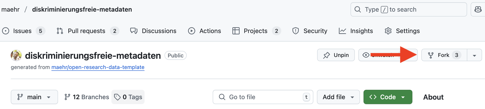
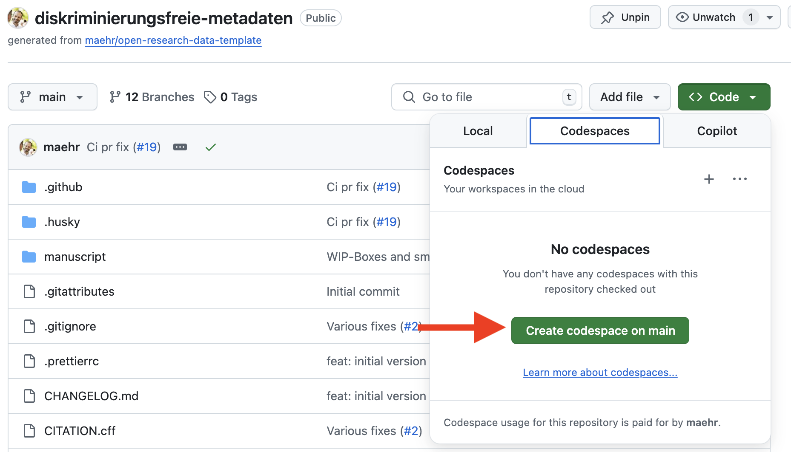
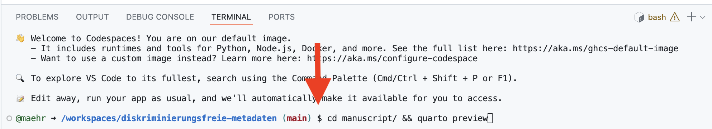

# Diskriminierungssensible Metadatenpraxis

This repository contains the source of the handbook _Diskriminierungssensible Metadatenpraxis. Ein Handbuch zur ethischen Beschreibung historischer Quellen und Forschungsdaten_. The handbook is in German.

Read the current version at <https://maehr.github.io/diskriminierungsfreie-metadaten/>.

[](https://github.com/maehr/diskriminierungsfreie-metadaten/issues)
[](LICENSE-AGPL.md)
[](LICENSE-CCBYSA.md)

## Status

The current version is **2.0.0-alpha.0**. It is a pre-release of the revised second edition. The text is not final. Feedback, corrections and additions are welcome on [GitHub Discussions](https://github.com/maehr/diskriminierungsfreie-metadaten/discussions/34).

The website offers the handbook as HTML, DOCX and PDF.

## What is the publication about?

The handbook gives practical guidance for the description of historical sources and research data in a way that is sensitive to discrimination. It is for historians, archivists, librarians and data curators in history and in GLAM institutions. The practice part follows the research data life cycle. The theory part explains the key terms: discrimination, bias, oppression and metadata.

## Versions

| Version                     | Date       | Where to read it                                              | Archive                                                            |
| --------------------------- | ---------- | ------------------------------------------------------------- | ------------------------------------------------------------------ |
| 2.0.0-alpha.0 (pre-release) | 2026-02-10 | <https://maehr.github.io/diskriminierungsfreie-metadaten/>    | No DOI                                                             |
| 1.0.1 (first edition)       | 2025-09-07 | <https://maehr.github.io/diskriminierungsfreie-metadaten/v1/> | [10.5281/zenodo.17073511](https://doi.org/10.5281/zenodo.17073511) |
| 1.0.0 (first edition)       | 2024-06-03 | Zenodo only                                                   | [10.5281/zenodo.11124720](https://doi.org/10.5281/zenodo.11124720) |

The concept DOI [10.5281/zenodo.11124719](https://doi.org/10.5281/zenodo.11124719) refers to all archived versions. It resolves to the latest archived version, which is 1.0.1.

The first edition also contains a mapping of the [Schlagwortindex GenderOpen](https://opengenderplatform.de/schlagwortindex) to the [Gemeinsame Normdatei (GND)](https://gnd.network/). Download it from the [v1 website](https://maehr.github.io/diskriminierungsfreie-metadaten/v1/data/genderopen_gnd_mapping.csv) or from Zenodo.

Until February 2026 the pre-release was on Quarto Pub. That address now redirects to GitHub Pages.

## How to cite

See the [CITATION.cff](CITATION.cff) file for citation information.

## Repository Structure

- `manuscript/index.qmd`: the main Quarto document (metadata and includes)
- `manuscript/sections/`: the chapters of the handbook
- `manuscript/images/`: the figures
- `manuscript/references.yaml`: the bibliography (source of truth)
- `manuscript/glossary.yaml`: the glossary terms
- `manuscript/_extensions/maehr/glossary/`: the Quarto extension for the glossary
- `specs/`: the outline and the specifications for each section
- `reviews/`: review notes
- `tools/scripts/`: the checks for citations and glossary terms
- `redirect/`: the redirect page for the old Quarto Pub address
- `TODO.md`: open editorial tasks

## Getting Started

We recommend using **GitHub Codespaces** for the easiest and fastest setup. It gives you a pre-configured, cloud-based development environment with everything ready to go — directly in your browser.

### 🚀 Quick Start with GitHub Codespaces

1. **Fork this repository** to your GitHub account (if needed).

<div align="center">
  
</div>

2. Click the green **`<> Code`** button at the top right of this repository.

3. Select the **“Codespaces”** tab and click **“Create codespace on `main`”**.

<div align="center">
  
</div>

4. GitHub will now build a container that includes:
   - ✅ Node.js (via `pnpm`)
   - ✅ Quarto

5. Once the Codespace is ready, you can preview the documentation locally inside the Codespace with:
   - **Open a terminal** in the Codespace (Terminal > New Terminal).
   - **Run the following command** to start the preview:

```bash
cd manuscript && quarto preview
```

<div align="center">
  
</div>

<details>
<summary>👩‍💻 Setup locally (Advanced users)</summary>

### Prerequisites

Make sure the following tools are installed locally:

- [Node.js](https://nodejs.org/en/download/) with [pnpm](https://pnpm.io/)
- [Quarto](https://quarto.org/docs/get-started/)
- [uv](https://docs.astral.sh/uv/) (for the citation check)

### Local setup steps

```bash
# 1. Install Node.js dependencies
pnpm install

# 2. Preview documentation
cd manuscript && quarto preview
```

</details>

## Use

Check that all files are properly formatted.

```bash
pnpm run check
```

Check that all citations exist in `manuscript/references.yaml`.

```bash
pnpm run check:citations
```

Check the glossary terms.

```bash
pnpm run check:glossary
```

Format all files.

```bash
pnpm run format
```

Run the wizard to write meaningful commit messages.

```bash
pnpm run commit
```

Preview the documentation.

```bash
cd manuscript && quarto preview
```

Render the documentation.

```bash
pnpm run render
```

GitHub Actions publishes the website. Each push to `main` starts the workflow `.github/workflows/quarto-publish.yml`. The workflow renders the handbook, prints the PDF, adds the first edition under `v1/` and publishes the result to the `gh-pages` branch.

## Support

This project is maintained by [@maehr](https://github.com/maehr). Please understand that we can't provide individual support via email. We also believe that help is much more valuable when it's shared publicly, so more people can benefit from it.

| Type                                   | Platforms                                                                                  |
| -------------------------------------- | ------------------------------------------------------------------------------------------ |
| 🚨 **Bug Reports**                     | [GitHub Issue Tracker](https://github.com/maehr/diskriminierungsfreie-metadaten/issues)    |
| 📊 **Report bad data**                 | [GitHub Issue Tracker](https://github.com/maehr/diskriminierungsfreie-metadaten/issues)    |
| 📚 **Docs Issue**                      | [GitHub Issue Tracker](https://github.com/maehr/diskriminierungsfreie-metadaten/issues)    |
| 🎁 **Feature Requests**                | [GitHub Issue Tracker](https://github.com/maehr/diskriminierungsfreie-metadaten/issues)    |
| 🛡 **Report a security vulnerability** | See [SECURITY.md](SECURITY.md)                                                             |
| 💬 **General Questions**               | [GitHub Discussions](https://github.com/maehr/diskriminierungsfreie-metadaten/discussions) |

## Roadmap

This handbook is a living document and will be updated regularly. The discussion of the handbook is open to everyone and we welcome feedback and suggestions for improvement on [GitHub Discussions](https://github.com/maehr/diskriminierungsfreie-metadaten/discussions).

## Contributing

All contributions to this repository are welcome! If you find errors or problems with the data, or if you want to add new data or features, please open an issue or pull request. Please read [CONTRIBUTING.md](CONTRIBUTING.md) for details on our code of conduct and the process for submitting pull requests.

## Versioning

We use [SemVer](http://semver.org/) for versioning. The [CHANGELOG](CHANGELOG.md) lists all versions and their dates.

## Authors and acknowledgment

- **Moritz Mähr** - _Initial work_ - [maehr](https://github.com/maehr)
- **Noëlle Schnegg** - _Initial work_ - [noelleschnegg](https://github.com/noelleschnegg)

See also the list of [contributors](https://github.com/maehr/diskriminierungsfreie-metadaten/graphs/contributors) who contributed to this project.

## License

The text and data in this repository are released under the Creative Commons Attribution-ShareAlike 4.0 International (CC BY-SA 4.0) License - see the [LICENSE-CCBYSA](LICENSE-CCBYSA.md) file for details. By using this data, you agree to give appropriate credit to the original author(s) and to indicate if any modifications have been made.

The code in this repository is released under the GNU Affero General Public License v3.0 - see the [LICENSE-AGPL](LICENSE-AGPL.md) file for details. By using this code, you agree to make any modifications available under the same license.
